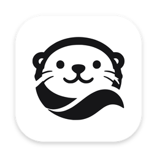

<p align="center"></p>

<h1 align="center">Otter</h1>

<p align="center">An inbox for your development work on remote machines.</p>

Run coding agents, shells, dev servers and tests on your dev boxes, and keep
track of all of them from one Mac app. Work lives in **workspaces** on your
hosts and keeps running when your laptop sleeps; Otter tells you when
something needs you. Or hand Otter a **feature**: a coding agent on the host
answers it if it's a question, builds it if it's a change, and Otter checks
the work, opens the pull request and brings you only the decisions that are
yours.

## What it does

### Hand over the work

- **Features.** Say what you want, in a workspace. The coding agent reads the
  code first. A question ("how does the backport tag work?") gets its answer,
  pointing to the code, and nothing changes; say "then change it" to have it
  built. A change gets a plan — tasks, acceptance criteria, the check that
  proves them — which Otter reviews. The agent then works through the tasks
  in one conversation; Otter runs the check, judges each criterion from the
  diff, pushes the branch, opens the pull request and follows CI. You accept
  it; Otter never merges or deploys.
- **You stay in charge.** Talk to Otter in the feature's conversation at any
  time: it passes on what the agent should know, stops it to redirect it,
  pauses, or plans again when the goal changes. What runs on its own is
  policy; anything that's yours — a destructive command, publishing, a plan
  Otter still has doubts about — waits for you. In **Settings** choose what
  Otter thinks with: a model provider's key, Claude Code's own sign-in on the
  host, or no model at all.
- **The Inbox.** Everything that needs you — features and workspaces, on
  every host — longest-waiting first, then what's working and what's done.
  Approve, answer, accept or retry right from the list.
- **Agents side by side.** When another feature's agent is busy in a
  workspace, a feature can get a worktree of its own. **Pause all features**
  holds everything at once.
- **Unattended work.** `otter trigger` starts a feature on a schedule (or on
  demand from a script), under a policy you set in advance: whether it may
  publish, how long a decision may wait for you, its budget.
- **Diagnostics.** A failure says why without its terminal and without your
  secrets; `otter doctor` says what's wrong with a host and what to do.

### Run it yourself

- **Workspaces, not terminals.** A workspace is one piece of work on a host:
  its files (an empty folder, a Git worktree of your repo, or an existing
  folder) and its sessions — Claude Code, Codex, shells, dev servers, tests.
- **What needs you, first.** The Workspaces view groups every workspace on
  every host into **Needs you**, **Working**, **Completed** and **Idle**. An
  agent that finished its turn or is waiting for approval, or a task that
  failed, moves to the top.
- **Notifications and the menu bar.** A macOS notification when something
  needs you; the menu bar shows how many, and clicking one opens it. Closing
  the window keeps Otter in the menu bar.
- **Coding agents that resume.** Claude Code and Codex run in their own
  sessions. Otter follows their transcripts to know when they're working,
  done or blocked, and restarting a session resumes its conversation.
- **Persistent sessions.** Sessions live on the host (in tmux, invisibly).
  Close the app, lose Wi-Fi, restart the daemon: they keep running, and the
  terminal reattaches with its history (scroll back with the wheel; selecting
  text copies it).
- **Paste screenshots into Claude Code.** Copy a screenshot on the Mac,
  press **Ctrl+V** in a Claude Code session on the host, and it's attached.
- **Browser login.** `aws sso login`, `gcloud auth login`, `gh auth login`
  and the like, run on a host, open their sign-in page in your Mac's browser
  and finish on the host — including logins that wait for a callback on a
  local port. Only https pages of known sign-in providers (AWS, Google,
  Microsoft, GitHub, HashiCorp) open. Works in the app and under
  `otter attach`.
- **Files.** Browse a workspace's files, download them, and upload by button
  or by dropping files on the window.
- **Host dashboard.** For each host: CPU, load, memory, disks, network and
  disk I/O, the busiest processes, and trends over 1 hour to 30 days — to
  see at a glance whether a box is fully occupied.
- **Port mappings.** Every port listening on a host, one click to open it on
  your Mac (a dev server at `localhost:5173`), and the reverse: Mac ports on
  the host. Mappings ride the existing SSH connection and can be kept across
  restarts.
- **No server setup.** Hosts are anything you reach with `ssh`. Otter
  installs and updates its small daemon (`otterd`) there; nothing listens on
  the network.
- **A CLI too.** `otter` does everything from a terminal, with `--json` for
  scripts.

## Install

Download the latest [release](https://github.com/alvingaopro/otter/releases):

- **App:** `Otter_<version>_macos_arm64.dmg` (Apple silicon) or
  `…_x86_64.dmg` (Intel). Drag Otter to Applications. It isn't notarized by
  Apple yet, so the first launch needs **System Settings → Privacy & Security
  → Open Anyway** (or `xattr -dr com.apple.quarantine /Applications/Otter.app`).
- **Command line:** in the app, **Otter → Install Command Line Tools…**
  (installs `otter` into `~/.local/bin`), or take
  `otter-<version>-<platform>.tar.gz` from the release.

A host needs `ssh` access from your Mac, tmux 3.2 or newer, and curl or wget.
For Claude's structured (SDK) mode it also needs Node.js 20 or newer; `otter
host install` puts the matching Claude worker next to `otterd`, and `otter
runtime status` says whether it's ready.

## Quick tutorial

1. **Add a host.** Open Otter → **Add a host** → a name and its SSH
   destination (as in `~/.ssh/config`, or `user@host`), or **This Mac**. If
   the host has no `otterd`, click **Install otterd and add**.
2. **Start a workspace.** **New** (⌘N) → a name, the host, and its files:
   an empty folder, a Git repository (it gets its own worktree and branch), or
   an existing folder. Pick **Claude Code** or **Codex**, optionally with a
   prompt, and a shell. **Create**.
3. **Work in it.** Each session is a tab with a live terminal. **+** adds
   another (a shell, an agent, a dev server, a test task); **Files** opens the
   file panel.
4. **Leave it running.** Switch to another workspace, close the window, or
   close the laptop. When an agent finishes or asks for approval, you get a
   notification and the workspace moves to **Needs you**. Click it, answer,
   and **Mark handled** when you're done.
5. **Check the host.** Click the host in the sidebar for its usage and
   trends, its listening ports (**Map to this Mac** opens one locally), and
   updates for `otterd`.

Paste a screenshot into Claude Code with **Ctrl+V** (⌘V pastes text as
usual). Restarting an agent session resumes its conversation.

### Hand over a feature

1. **New feature** → a title, what you want in your words, and the workspace
   to do it in (a Git repository workspace, for a pull request). **Start**.
2. The coding agent reads the code. Asked a question, it answers in the
   feature's conversation and the feature is done — say "then change it" to
   have it built. Otherwise Otter posts the plan and the agent gets to work.
3. Say what you like in the conversation along the way. What's yours to
   decide shows up in the **Inbox** (⌘1) and as a notification.
4. Once the work checks out, Otter asks to push the branch and open the pull
   request, and follows CI (the host's `gh` does the GitHub part). Look it
   over and **Accept**.

### From the command line

```sh
otter host add dev-01                                 # anything `ssh dev-01` reaches
otter new billing --repo git@github.com:org/api.git --agent claude --prompt "Fix the flaky test"
otter ls --watch                                      # NEEDS YOU / WORKING / …
otter attach billing/claude                           # Ctrl-] detaches; it keeps running
otter ack billing                                     # mark what it asked for as handled

otter feature new "CSV export" --request "Export the timeline as CSV" --workspace billing
otter feature start csv                               # a feature: its id, title, or the start of one
otter feature show csv                                # where it stands, what waits on you
otter feature decide csv dec_…                        # approve (or --deny, --answer A)
otter feature accept csv
```

<details>
<summary>All commands</summary>

```
otter host add|list|rm|default|status|install|shutdown
otter doctor [host]                                 # what's wrong with your hosts, and what to do
otter new <name> [--host H] [--agent codex|claude] [--prompt P] [--no-agent] [--no-shell]
                 [--repo URL [--branch B] [--base REV] | --dir PATH] [--no-wait]
otter ls [--watch] [--table] [--archived]
otter ack <ws[/session]>
otter workspace show|prepare <ws>
otter workspace archive|unarchive <ws>              # stop and put away, files kept
otter workspace rename <ws> <name>                  # the name only: directory, branch, sessions stay
otter workspace brief <ws> [--title T] [--description D]
                     [--constraint C] [--reference R] [--decision D] [--clear]   # why it exists
otter workspace delete <ws> [--yes] [--force]       # --force: discard uncommitted work
otter start <ws> [--name N] [--kind terminal|service|task] [-- command]
otter start <ws> --agent [codex|claude] [--prompt P]
otter session stop|restart|delete <ws/session>      # restart resumes an agent's conversation
otter session rename <ws/session> <name>
otter attach <[host:]ws[/session]>
otter logs <ws/session> [-n LINES]
otter send <ws/session> <text> [--no-enter]
otter events [-n N] [-f]
otter feature new <title> [--request R] [--workspace WS] [--host H]
otter feature ls | show <[host:]feature> | history <feature> | start <feature>
otter feature message <feature> <text>              # to Otter; it passes on what the coding agent needs
otter feature redirect <feature> <text>             # stop the agent's current work; this goes next
otter feature interrupt|cancel <feature>
otter feature pause|resume <feature> | --all [--host H]
otter feature own-workspace <feature>               # a worktree of its own, when another agent has the workspace
otter feature decide <feature> <decision> [--deny | --answer A | --answer-for "Q=A" …]
otter feature accept <feature> [--anyway]           # done; --anyway past a gate that hasn't passed
otter trigger add <name> --workspace WS --request R [--every 6h | --daily HH:MM] [--publish]
                  [--wait-limit 30m] [--max-attempts N] [--max-minutes N]
otter trigger ls | rm <name> | run <name> [--occurrence T]
otter conversation ls [--feature F] | show <[host:]conv> | history <conv> [--after CURSOR]
otter runtime status [--host H]                     # how the coding agent runs, and what it can do
```

Add `--json` to any command for machine-readable output.
</details>

## How it works

```
Otter.app / otter ──ssh──▶ otterd (one per host) ──▶ tmux sessions ──▶ Claude Code, Codex, shells…
        ▲                       │
        └── events, attach ─────┘   state in ~/.otter on the host
```

The app and the CLI are thin clients of the same Rust library. Everything
runs on the host under `otterd`, reached over your own SSH (`ssh host otterd
dial`); the daemon is the source of truth, so clients can come and go.

Features run there too. `otterd`'s controller is deterministic code that owns
each feature's lifecycle, budgets and what may run; the coding agent (Claude
Code) reads the code, plans and does the work; a model you choose reviews
plans, decides what policy leaves open and judges the evidence. A model never
moves a feature itself, and never decides what is yours.

## Developing

```sh
direnv allow            # or: nix develop — Rust, tmux, Node
cargo test              # daemon, CLI and end-to-end tests (real otterd + tmux)
cd apps/desktop && npm install && npm run tauri dev
```

Architecture: [`docs/design.md`](docs/design.md) · decisions:
[`docs/decisions.md`](docs/decisions.md) · wire protocol:
[`docs/protocol.md`](docs/protocol.md) · notes for coding agents:
[`AGENTS.md`](AGENTS.md).
